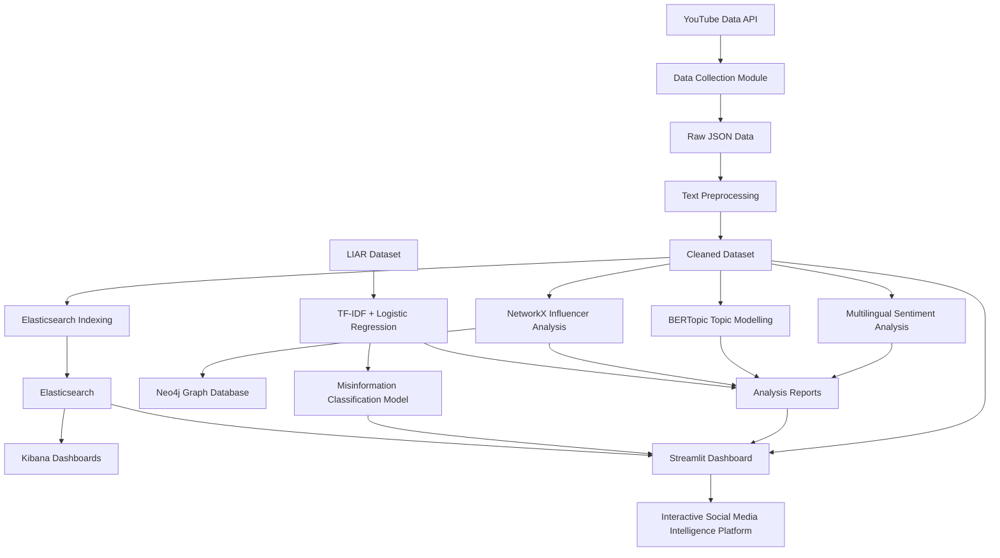

# DS-03 Social Media Intelligence Platform
## System Architecture

## Main Components

1. **Data Collection:** Collects YouTube videos and comments.
2. **Preprocessing:** Cleans text, detects languages and removes duplicates.
3. **Sentiment Analysis:** Performs multilingual sentiment classification.
4. **Topic Modelling:** Discovers topics using BERTopic.
5. **Network Analysis:** Identifies influential channels using PageRank and community detection.
6. **Misinformation Classification:** Uses TF-IDF and Logistic Regression trained on LIAR.
7. **Neo4j:** Stores the influencer interaction graph.
8. **Elasticsearch:** Indexes cleaned social media records.
9. **Kibana:** Provides search and visualization dashboards.
10. **Streamlit:** Integrates project results into one interactive dashboard.

## Data Collection Limitation

Reddit API credentials were unavailable during implementation. Therefore, the current prototype uses collected YouTube data rather than data from both platforms.
